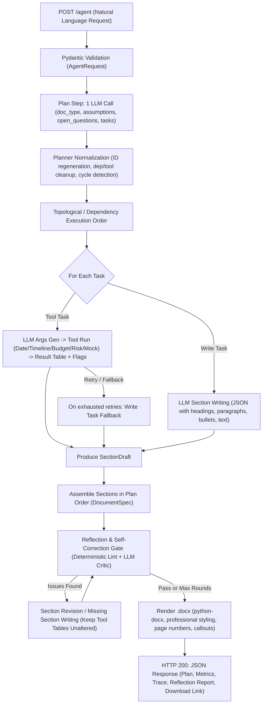

# Autonomous Document Agent (`docgen-agent`)

A production-grade, hand-crafted FastAPI service where `POST /agent` takes a natural-language business request, **autonomously plans its own task list**, executes each task with Python tools and an LLM, **self-reviews its output via multi-round reflection**, and renders an executive-ready Word document (`.docx`).

> **Zero Heavy Frameworks**: Hand-written orchestration with standard `httpx` and `pydantic`. No LangChain, LlamaIndex, CrewAI, or vendor SDKs.

---

## 1. Overview & Architecture



### Architectural Principles
1. **Numbers from Tools, Prose from LLM**: Quantitative schedule, budget, and risk data are calculated strictly in Python. The LLM produces narrative context and analysis.
2. **Deterministic Resilience**: LLM JSON output errors are repaired with automated feedback retry loops. In persistent tool failures, the agent gracefully degrades to LLM writing with warnings.
3. **Stateless Orchestration**: `DocumentAgent` maintains no per-request state on `self`, using a scoped `RunState` object per execution to ensure thread safety across concurrent FastAPI threads.
4. **Authoritative Figures**: Tool-generated tables cannot be altered or deleted during reflection revisions.

---

## 2. Mandatory Engineering Improvement: Reflection / Self-Check

### What
After assembling the initial draft document from tool results and LLM writing, the agent executes an automated, multi-round quality check before rendering the Word document.

### Why
Single-pass LLM generation frequently suffers from subtle omissions:
- Forgetting an explicit user constraint (e.g. multi-region redundancy or team responsibilities).
- Inserting vague placeholder text (`TBD`, `[insert date]`, `lorem ipsum`).
- Inadvertently contradicting numbers computed by tools.
- Leaving a critical section thin or superficial.

In an autonomous flow without humans in the loop, the agent must inspect its own draft, catch defects, and revise them.

### How It Works
The reflection engine operates in configurable rounds (`MAX_REFLECTION_ROUNDS`, default 1):
1. **Deterministic Free Linting (`lint_document`)**:
   - Detects empty sections.
   - Detects thin LLM sections (< 25 words with no table).
   - Scans for forbidden placeholder patterns (`TBD`, `TBC`, `XXX`, `to be determined`, `[insert ...]`, `[placeholder]`, `lorem ipsum`).
   - Identifies duplicate section headings.
2. **LLM Critic (`reflect`)**:
   - Evaluates coverage against the original user request, assumptions, and tool flags.
   - Assigns a score (1-10) and flags up to 4 concrete defects.
3. **Targeted Remediation**:
   - `fix` issues are grouped by section and corrected via targeted `revise_section` calls without disturbing other sections.
   - For tool-generated sections, **the authoritative table is restored automatically after revision**, preventing the LLM from tampering with computed math.
   - `missing` issues trigger a `write_section` call that appends an additional section (`x1`, `x2`, etc.) to the document.

---

## 3. Tool Suite

| Tool | Parameters | Behavior & Mathematical Integrity |
|---|---|---|
| `get_current_date` | None | Returns today's ISO date for reference. |
| `build_timeline` | `start_date`, `deadline`, `phases[{name, duration_weeks, parallel_with_previous}]` | Computes sequential or parallel phase schedules. Detects and flags deadline overruns with exact day counts. |
| `build_budget` | `currency`, `items[{name, quantity, unit_cost}]`, `contingency_pct`, `budget_cap` | Calculates itemized subtotals, contingency, and totals. Flags budget cap overages with dollar and percentage overruns. |
| `build_risk_register` | `risks[{risk, likelihood, impact, mitigation}]` | Calculates score = likelihood × impact (1-5). Classifies High (>=15), Medium (>=8), Low (<8). Sorts descending and flags High risks. |
| `get_mock_data` | `topic` (`company_profile`, `team_roster`, `sales_kpis`, `it_landscape`) | Retrieves standardized baseline datasets. Unknown topics raise human/LLM-readable error listing valid topics. |

---

## 4. Quick Start

### 1. Prerequisites & Environment Setup
Requires Python 3.11+.

```bash
# Navigate to project
cd docgen-agent

# Create and activate virtual environment
python -m venv .venv

# Windows
.venv\Scripts\activate
# Linux/macOS
source .venv/bin/activate

# Install dependencies
pip install -r requirements.txt
```

### 2. Configure Environment Variables
Copy `.env.example` to `.env`:

```bash
cp .env.example .env
```

Set your preferred provider (Groq by default):
```env
LLM_PROVIDER=groq
LLM_MODEL=llama-3.3-70b-versatile
GROQ_API_KEY=gsk_your_groq_api_key_here
```

### 3. Run the Service
```bash
uvicorn app.main:app --reload --port 8000
```
Interactive OpenAPI documentation will be available at: `http://localhost:8000/docs`.

### 4. Example Request
```bash
curl -X POST http://localhost:8000/agent \
  -H "Content-Type: application/json" \
  -d '{
    "request": "Create a project proposal for building a customer support chatbot for an online retail company. Include scope, timeline, budget estimate and key risks.",
    "include_document_base64": false
  }'
```

---

## 5. API Reference

### `POST /agent`
Takes a business request and runs the autonomous pipeline.

**Request Body (`AgentRequest`):**
```json
{
  "request": "Natural language request (10 - 4000 chars, containing at least one letter)",
  "include_document_base64": false
}
```

**Response (`200 OK`):**
```json
{
  "request_id": "3f2c7a8b9c0d1e2f3a4b5c6d7e8f9a0b",
  "status": "completed",
  "message": "Created 'Customer Support Chatbot Proposal' (proposal) with 5 sections from 5 tasks. 3 assumptions were made and are listed in the document. Self-review 9/10 after 1 revision.",
  "plan": {
    "title": "Customer Support Chatbot Proposal",
    "doc_type": "proposal",
    "audience": "Executive Leadership",
    "assumptions": ["..."],
    "open_questions": ["..."],
    "tasks": [
      {
        "id": "t1",
        "title": "Executive Summary",
        "description": "High-level overview",
        "tool": null,
        "depends_on": ["t2", "t3", "t4", "t5"],
        "status": "done",
        "attempts": 1,
        "used_fallback": false,
        "summary": "Written section with 142 words.",
        "error": null
      }
    ]
  },
  "reflection": {
    "initial_score": 6,
    "final_score": 9,
    "issues_found": 1,
    "issues": ["[missing] Missing multi-region redundancy architecture analysis"],
    "revisions": ["Added missing section 'Missing multi-region redundancy architecture': ..."],
    "rounds": 1,
    "remaining_issues": [],
    "critic_error": null
  },
  "document": {
    "filename": "customer-support-chatbot-proposal-3f2c7a8b9c0d1e2f3a4b5c6d7e8f9a0b.docx",
    "download_url": "/documents/3f2c7a8b9c0d1e2f3a4b5c6d7e8f9a0b",
    "size_bytes": 41234,
    "base64": null
  },
  "warnings": [],
  "trace": ["Beginning autonomous planning step.", "..."],
  "metrics": {
    "llm_calls": 9,
    "elapsed_seconds": 12.4
  }
}
```

| HTTP Status | Condition |
|---|---|
| `200 OK` | Generation succeeded (`completed` or `completed_with_warnings`). |
| `422 Unprocessable Content` | Validation failure (request length, empty) OR planner rejected request (`can_fulfil=false`). |
| `404 Not Found` | Document ID not found or malformed. |
| `502 Bad Gateway` | Unusable LLM output after retries, or no section could be generated. |
| `503 Service Unavailable` | LLM service unreachable, authentication failure, or rate limit exhausted. |

### `GET /documents/{request_id}`
Securely downloads the generated `.docx` document. Validates `^[0-9a-f]{32}$` to prevent directory traversal.

### `GET /health`
Returns runtime status, provider, and active model.

### `GET /tools`
Lists all registered tools, their schemas, and descriptions.

---

## 6. Testing

The entire unit and integration test suite runs offline without requiring API keys:

```bash
# Run all offline tests quietly
pytest -q

# Run with verbose output
pytest -v
```

### Test Coverage Highlights
- **Schemas (`tests/test_schemas.py`)**: S1-S5 verifying row padding/truncation, dict-row mapping, bullet coercion, request bounds, and critic score clamping.
- **LLM Layer (`tests/test_llm.py`)**: L1-L8 testing JSON extraction, backoff retries, 429 `Retry-After`, 401 immediate abort, 400 `response_format` downgrade, and bearer auth headers.
- **Deterministic Tools (`tests/test_tools.py`)**: T1-T8 verifying schedule math, parallel phases, deadline overruns, budget cap overages, risk scoring boundaries, and error messages.
- **Planner (`tests/test_planner.py`)**: P1-P4 verifying task truncation, ID normalization, cycle breaking, and dependency execution ordering.
- **Word Document Builder (`tests/test_docx_builder.py`)**: D1-D5 validating styles, repeated table headers (`w:tblHeader`), page number fields (`PAGE` / `NUMPAGES`), and numeric cell alignments.
- **Agent Orchestrator (`tests/test_agent.py`)**: A1-A12 verifying standard flow, complex flow with retries and flags, tool fallback, critic JSON errors, table restoration, security delimiters, and multi-threaded isolation.
- **API Endpoints (`tests/test_api.py`)**: API1-API7 validating HTTP status codes, base64 encoding, 422 rejected plans, 502/503 handlers, and secure file downloads.
- **Live Smoke (`tests/test_live_smoke.py`)**: Opt-in live test (`RUN_LIVE=1 pytest -k test_live_smoke`).

---

## 7. Demo Script

Run the automated demo script against a local server:

```bash
python scripts/demo.py --base-url http://localhost:8000
```
This script executes both the standard retail chatbot proposal and the complex/conflicting cloud migration test, displays the task execution trace and reflection scores, and downloads the `.docx` documents into `demo_output/`.

---

## 8. Design Decisions & Trade-offs

1. **Hand-Crafted Orchestration vs Multi-Agent Frameworks**:
   - *Decision*: Avoid LangChain, CrewAI, or AutoGen in favor of direct HTTP calls, strict Pydantic models, and custom loops.
   - *Trade-off*: Requires explicit retry logic, prompting conventions, and parsing code. In return, the entire lifecycle is transparent, debuggable line by line, and has zero framework overhead or breaking upstream changes.
2. **Stateless Agent with Scoped RunState**:
   - *Decision*: Store per-request variables (`request_id`, call counts, task records, flags) in an ephemeral `RunState` object rather than on `self`.
   - *Trade-off*: Passing `state` through helper methods adds a parameter, but guarantees thread safety under FastAPI's multithreaded worker pool.
3. **Restoring Authoritative Tables During Revision**:
   - *Decision*: When the critic revises a tool-generated section, the original table is re-injected.
   - *Trade-off*: The LLM cannot add extra manual columns during revision, but guarantees that mathematical figures and financial formulas remain uncorrupted by hallucinations.

---

## 9. Scaling & Production Path

- **Horizontal Scaling**: Because `DocumentAgent` is completely stateless, multiple FastAPI worker containers can sit behind an NGINX or ALB load balancer.
- **Asynchronous Task Queue**: For workloads with large document sections or low LLM rate limits, accept requests with `202 Accepted` returning a `job_id`, process in Celery/Arq background workers, and stream real-time progress via Server-Sent Events (SSE) or WebSockets.
- **Cloud Storage**: Replace local filesystem storage with an `S3` or `Google Cloud Storage` client behind a storage protocol interface.
- **Provider Redundancy**: Implement an automated fallback provider chain (e.g., attempt Groq primary; on persistent 429/503 fall back to Ollama or Gemini).
